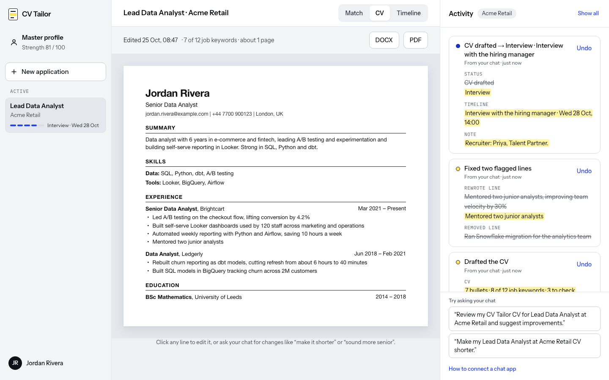
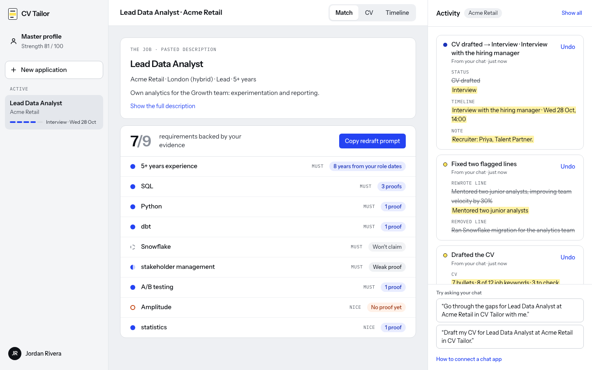

# CV Tailor

Keep a record of your whole career, tailor a standout, ATS-friendly CV for every job, and track each application, **by talking to your own AI chat**.

CV Tailor is an [MCP](https://modelcontextprotocol.io) server plus a web app:

- **Your chat app** (Claude Desktop, Claude Code, claude.ai, ChatGPT…) does the thinking and writing, on your own plan. No AI API key needed.
- **CV Tailor** stores your profile and applications, reads job links, flags CV lines you'll need to back up in an interview, and shows everything live in the browser. There you can edit, undo, and download PDF or DOCX.



## Features

- **Master profile as an evidence bank.** Every role, project and achievement is stored once and reused for every job. Your chat asks questions to fill gaps: missing numbers, thin roles, skills you list but never show.
- **Requirement-to-evidence matching.** Paste a job link (Greenhouse, Lever, Ashby, Workday, most career pages) or the description. Each requirement shows the achievements that prove it, or a gap to talk through.
- **Ambition levels.** Your master profile is the plain factual record; each CV reframes it as strongly as you choose. For each application you pick how far the framing may stretch the facts: **Faithful** (your facts, framed for the job), **Polished** (numbers pushed up, the responsibilities that come with your work claimed outright), **Elevated**, the default (a clear level more senior: bigger scope and numbers, initiatives led, adjacent skills mapped onto every requirement) or **Bold** (the CV a model candidate for the role would have, built on your real background). Employers, job titles, dates, degrees and certifications are never invented. Your chat writes to that level in plain language, and CV Tailor flags lines that are still in the profile's wording or lean on buzzwords. The CV tab highlights each line by its rating, with a legend, and outlines any line above the level you chose. Highlights never appear in the PDF or DOCX.
- **Checks on every CV.** CV Tailor checks the CV before saving:
  - titles, employers and dates always come from your profile;
  - numbers and bullets that go beyond your profile are flagged, so you can prepare to back them up in an interview;
  - skills your profile doesn't show are kept, and listed for you to prepare;
  - requirements you said you lack are never claimed.
- **ATS-friendly export.** A single-column layout with standard headings and real text, as PDF or DOCX.
- **Application tracking.** A stage for each job (Saved → CV → Applied → Interview → Offer), with a dated timeline and notes, kept up to date from your chat.
- **Live activity feed with undo.** Every change your chat makes appears in the browser within seconds and can be undone.



## How it works

```
Your chat app ──MCP──▶ /mcp (10 tools) ──▶ database ◀── web app (profile, match, CV, timeline, activity)
```

1. You talk to your chat as usual. It calls CV Tailor's tools to read your profile and jobs, and to save changes.
2. CV Tailor checks and stores everything, and records each change with what it replaced, so it can be undone.
3. The web app shows it all live, and is where you review, edit and download.

**Built with** Next.js 16, TypeScript, Tailwind CSS 4, the MCP TypeScript SDK, and Postgres/Supabase or SQLite. PDFs are made with pdfkit and Word files with docx.

## Run it locally

```bash
npm install
npm run dev        # web app at http://localhost:3000, MCP endpoint at http://localhost:3000/mcp
```

Requires Node 22.5+. Without `DATABASE_URL`, data is stored in a local file, `./data/cv-tailor.db`. Keep the app running while you chat.

### Connect your chat (local)

**Claude Desktop.** Settings › Developer › Edit Config, add this, then restart Claude Desktop:

```json
{
  "mcpServers": {
    "cv-tailor": {
      "command": "npx",
      "args": ["-y", "mcp-remote", "http://localhost:3000/mcp"]
    }
  }
}
```

**Claude Code**

```bash
claude mcp add --transport http cv-tailor http://localhost:3000/mcp
```

Locally, no password or token is needed: the MCP endpoint only answers requests addressed to localhost.

## Deploy to Vercel

Hosting it means your chat can reach it from anywhere, including claude.ai on the web and mobile, and ChatGPT, without your computer running.

1. **Create a Supabase project** (free tier is plenty) at supabase.com. Then open **Connect**, choose **Transaction pooler** (port 6543, which suits Vercel's serverless functions), and copy the connection string with your database password filled in. That's your `DATABASE_URL`.

   CV Tailor creates its tables automatically on first use, in a separate `cv_tailor` schema. Supabase's public API only exposes the `public` schema, so your data isn't reachable with the project's API keys; only this connection string can read it.

   To copy your local data across: `DATABASE_URL="<connection string>" node scripts/copy-to-postgres.mjs`

2. **Import the project in Vercel** (push it to GitHub, then vercel.com › Add New › Project), or run `npx vercel` in this folder.

3. **Set environment variables** in the Vercel project (Settings › Environment Variables), then redeploy:

   | Variable | Value |
   |---|---|
   | `DATABASE_URL` | the Supabase connection string from step 1 |
   | `APP_PASSWORD` | the password for the web app |
   | `MCP_TOKEN` | a long random secret: `openssl rand -hex 24` |
   | `APP_URL` | optional; defaults to the production address |

   Without `APP_PASSWORD` the deployed app refuses to serve anything; without `MCP_TOKEN` the MCP endpoint refuses every request.

4. **Connect your chat** to `https://<your-app>.vercel.app/mcp`. The app's Activity panel shows these snippets with your address filled in.

   - **Claude Desktop** (token sent as a header):

     ```json
     {
       "mcpServers": {
         "cv-tailor": {
           "command": "npx",
           "args": ["-y", "mcp-remote", "https://<your-app>.vercel.app/mcp", "--header", "Authorization:${AUTH_HEADER}"],
           "env": { "AUTH_HEADER": "Bearer <your MCP_TOKEN>" }
         }
       }
     }
     ```

   - **Claude Code:** `claude mcp add --transport http cv-tailor https://<your-app>.vercel.app/mcp --header "Authorization: Bearer <your MCP_TOKEN>"`
   - **claude.ai** (web and mobile): Settings › Connectors › Add custom connector, URL `https://<your-app>.vercel.app/mcp?key=<your MCP_TOKEN>`.
   - **ChatGPT:** Settings › Connectors (developer mode), same URL.

**Security (single user).** Anyone with the password can use the web app, and anyone with the token can read and change your data through the MCP endpoint. Keep both secret; to revoke access, change them in Vercel and redeploy. Changing the password signs every browser out. The token sits in the connector URL for apps that only accept a URL, so treat that URL like a password.

### Accounts: invite other people

With Google sign-in configured, CV Tailor becomes invite-only and multi-user: everyone signs in with Google, gets their own profile, applications and CVs, and connects their own chat app with their own key. Until it's configured, the app keeps running as a single user (above).

1. **Create a Google OAuth client.** In [Google Cloud Console](https://console.cloud.google.com/apis/credentials): create a project, set up the OAuth consent screen (External; app name "CV Tailor"; add your email as a test user while it's in testing, or publish it), then **Create credentials › OAuth client ID › Web application**. Add these **Authorized redirect URIs**:
   - `https://<your-app>.vercel.app/api/auth/google/callback`
   - `http://localhost:3000/api/auth/google/callback` (for local development)
2. **Set these in Vercel**, then redeploy:

   | Variable | Value |
   |---|---|
   | `GOOGLE_CLIENT_ID` | from the OAuth client |
   | `GOOGLE_CLIENT_SECRET` | from the OAuth client |
   | `SESSION_SECRET` | a long random secret for signing sign-in cookies: `openssl rand -hex 32` |
   | `OWNER_EMAIL` | your Google email: you can always sign in, and you manage invites |

   `APP_PASSWORD` is no longer used once these are set. Keep `MCP_TOKEN`: it carries on working as your key, so existing chat connections don't break.
3. **Sign in** with your Google account. Everything created before accounts were turned on moves to your account.
4. **Invite people** from **People and invites** (bottom of the sidebar): create a link, optionally locked to one Google email, and send it. Links work once and last 14 days. You can remove people there too, which deletes their data.
5. **Each person connects their own chat**: Activity › How to connect a chat app › **Make my key**. The key is shown once, already filled into the connector address. Making a new key replaces the old one.

Each person only ever sees their own data, in the web app and through their key.

**Running a local model instead** (LM Studio, or Ollama through an MCP-capable client like Open WebUI): point its MCP settings at the same URL. Small models are weaker at multi-step tool use, but the evidence checks still apply.

## Using it

Ask your chat things like:

- "Help me build my CV Tailor profile. Here's my CV." (attach it)
- "Ask me questions to strengthen my profile."
- "Start an application for <job link>, then go through the gaps with me."
- "Draft my CV for that job." / "Make it shorter." / "Sound more senior."
- "I applied today." / "Interview on Tuesday at 2pm. Help me prepare."

Every change shows up in the web app's **Activity** panel with **Undo**. Undo is refused if a later change touched the same data, so undo the newer one first.

## Tools

| Tool | What it does |
|---|---|
| `get_overview` | Profile strength, questions that would strengthen it, applications and their ids |
| `get_profile` | Full profile with entry and achievement ids |
| `update_profile` | Add, change or remove contact details, entries, achievements and skills |
| `create_application` | Start an application from a link (Greenhouse, Lever, Ashby, Workday, most career pages) or pasted text |
| `set_job_details` | Record the job's requirements as read by your chat |
| `get_application` | Requirements with the evidence behind each, the CV with ids, timeline, notes, download links |
| `mark_not_claimed` | Requirements you don't have; the CV never claims them |
| `save_cv` | Save a CV your chat wrote. Every bullet cites achievement ids and carries an ambition rating |
| `edit_cv` | Replace, remove or add bullets; change headline or summary |
| `update_application` | Stage changes, dated timeline events, notes, and the CV's ambition level |

**Checks on every CV** (`src/lib/tailor.ts`). They flag lines to prepare for; they don't block anything:
- Titles, employers and dates come from the profile, never from the chat.
- Numbers that aren't in a bullet's cited sources are flagged.
- Bullets with no sources are flagged.
- Skills the profile doesn't show are listed.
- A requirement you said you lack is flagged if it appears.

The warnings go back to your chat and appear in the CV view.

## Code map

```
src/lib/mcp/server.ts   MCP tools and the instructions sent to your chat
src/app/mcp/route.ts    Streamable HTTP endpoint (stateless); runs each request as the key's user
src/lib/activity.ts     Change log with snapshot-based undo
src/lib/tailor.ts       Turns a CV plan into CV content and checks it against the evidence
src/lib/requirements.ts Links each job requirement to the achievements that prove it
src/lib/applications.ts Status, timeline and notes
src/lib/db.ts           Small JSON document store, scoped per user: Postgres/Supabase (DATABASE_URL) or a local SQLite file
src/proxy.ts            Sign-in gate: Google accounts, or the single-user APP_PASSWORD
src/lib/session.ts      Who a request belongs to: signed cookies, and the MCP key's user
src/lib/users.ts        Invite-only sign-in, invites and per-user MCP keys
src/lib/google.ts       Google sign-in (OpenID Connect with PKCE)
src/components/workspace/  Sidebar, documents (profile, match, CV, timeline) and the activity panel
```

## Roadmap

- Email or magic-link sign-in as an alternative to Google.
- A cover letter tool, using the same evidence rules.
- Interview practice that draws on your evidence and records new stories it uncovers.

## License

MIT. See [LICENSE](LICENSE).
